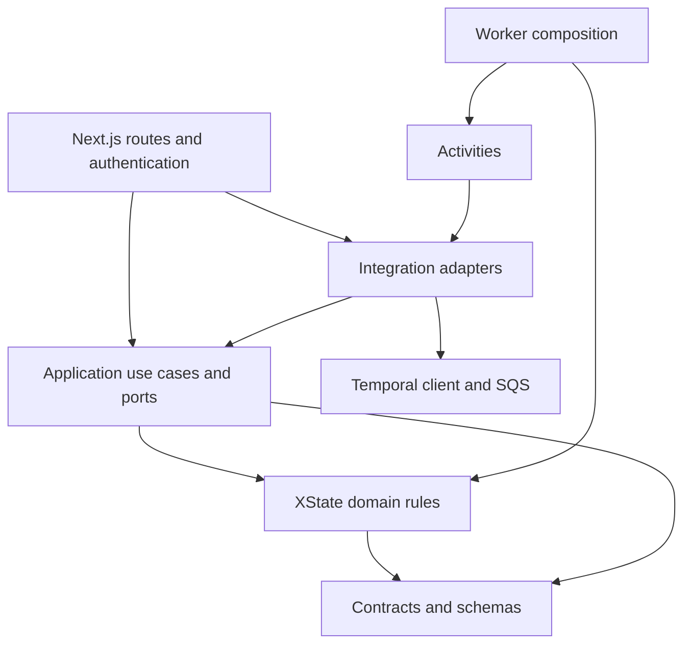

# DistrictWorkflow architecture

## Application components

Next.js owns pages, authentication and HTTP APIs in `apps/web`. Temporal runs
independently in `apps/worker`, coordinating durable work, retries and notifications.
XState evaluates task transitions as pure functions inside the workflow. The
Training Fund workflow has a persisted path for new intake and retains its original
two-argument path for existing executions.

### Workspace boundaries

- `packages/contracts`: serializable types, JSON Schema, validation and stable workflow IDs.
- `packages/domain`: deterministic XState machines and business decisions; depends on contracts.
- `packages/application`: use cases and injected infrastructure interfaces; depends on domain/contracts.
- `packages/integrations`: AWS/Temporal clients, email delivery, token signing and runtime configuration; implements application interfaces.
- `packages/persistence`: PostgreSQL/Drizzle schema, migrations, connection pool and Training Fund repository.
- `apps/web`: HTTP transport, session/origin enforcement and service composition.
- `apps/worker`: workflow/activity registration, SQS intake and operator processes.

Applications may depend on packages; packages must not import application source.
Domain code must not import Next.js, Temporal, AWS clients, environment configuration
or Node I/O. Workflow imports must remain deterministic; type-only activity imports
do not bring their implementations into the workflow bundle. Avoid package barrels
that mix domain definitions and infrastructure.

Next.js routes call shared services directly. The former private HTTP API and its
service-key configuration are removed. Member/staff session checks and signed-task
capability checks remain at their existing public endpoints. The SQS consumer is
still independently supervised; it acknowledges only after Temporal accepts a
start or confirms a duplicate. Duplicate-error classification is injected by the
Temporal adapter rather than imported into application logic.

Yarn uses one root install and lockfile. Shared TypeScript packages export compiled
modules; build packages before either app, using the root scripts. Deploy built
packages and dependencies alongside each app. See the [root guide](../README.md).

## Application database decision

PostgreSQL is the selected application database, with **Drizzle ORM** for typed
queries and TypeScript schema definitions and **Drizzle Kit** for schema migrations.
The first implementation includes a Training Fund ledger, versioned snapshots,
reviewed SQL migrations, a pooled node-postgres driver and local Docker Compose
configuration. See [database setup and consistency](../packages/persistence/README.md).

Drizzle fits the existing TypeScript stack and keeps schema definitions close to
application types while producing SQL migrations that can be reviewed. Phinx is
a PHP migration tool, rather than a complete backend; adopting it here would add
PHP and Composer solely for migration management.

The alternatives considered are:

| Tool | Fit |
| --- | --- |
| Drizzle ORM + Drizzle Kit | Selected: typed queries, TypeScript schema definitions and generated SQL migrations. |
| node-pg-migrate | A solid standalone alternative when writing explicit TypeScript or SQL migrations without an ORM; the closest equivalent to Phinx. |
| Prisma ORM | An alternative with its own schema language and integrated query and migration tooling. |
| Phinx | Appropriate for PHP projects, but adds another language toolchain here. |

References: [Drizzle migrations](https://orm.drizzle.team/docs/migrations),
[node-pg-migrate](https://salsita.github.io/node-pg-migrate/),
[Prisma migrations](https://docs.prisma.io/docs/cli/migrate) and
[Phinx](https://phinx.org/).

## Database boundaries

PostgreSQL stores immutable Training Fund submissions, the latest state and an
append-only transition history. Snapshot and audit writes share a transaction;
row locks and unique application/revision keys make activity retries idempotent.
The application's database is separate from Temporal's internal persistence. The
local Temporal server retains its own SQLite history under `apps/worker/.data/`.

New consumer starts include `{ persistState: true }`. The workflow persists through
activities, serializes decisions and confirms Updates after database commit.
Existing two-argument histories retain their original command sequence and need a
separate backfill. No live database I/O occurs inside workflow code.

SQS buffers submissions before workflow initialization; HTTP 202 still means queued.
The consumer checks PostgreSQL before starting a previously recorded application,
including after Temporal history expires. If a start succeeds before its first DB
write, Temporal owns recovery through the retryable initialization activity. Changed
payloads cannot reuse an existing ledger identity. Legacy unpersisted workflows still
depend on Temporal retention until explicitly backfilled.

Next.js uses Temporal for live task queries and can read a completed database snapshot
when history is no longer available. Pending executions are not reconstructed from
snapshots, and service outages are not interpreted as expired history.

Production provisioning, credentials, backup/retention policy and a legacy backfill
remain environment-specific work. The local Compose definition is for development.

## Migration approach

Define the application schema in TypeScript using Drizzle, generate SQL migrations
with Drizzle Kit, and review and commit the SQL and generated migration metadata
alongside the code. Apply committed migrations through a controlled deployment
step before application changes that require them. Use generated migrations as
the production change history rather than directly pushing schema changes.

Validate migrations against a disposable PostgreSQL database before deployment.
For changes spanning deployments, keep the schema compatible with running API
services and workers until they have been upgraded. Data backfills and destructive
changes require explicit rollout and recovery plans.
