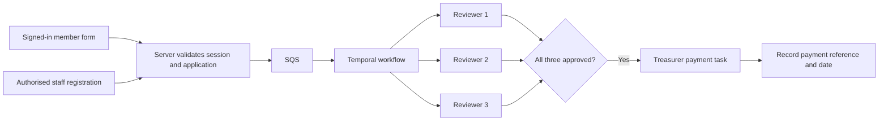

# District Training Fund

An application starts in the members website or is registered by workflow staff,
enters through SQS, waits for each of three assigned people to
approve, then becomes a payment task for a separate district treasurer. Recording
payment completes the workflow. No bank transfer is initiated by this application.



## Message contract

The canonical **JSON Schema, draft 2020-12**, is
[`../packages/contracts/src/training-fund/application.schema.json`](../packages/contracts/src/training-fund/application.schema.json).
An example is [`training-fund.application.example.json`](training-fund.application.example.json).
Send the JSON object as the raw SQS message body, with no SNS envelope. Enable
format validation (AJV plus `ajv-formats`); reject unknown properties. The producer
and consumer both validate. In addition to the schema, they enforce requested
funding <= course cost, a cross-field check that standard JSON Schema cannot
express. Money is GBP in integer pence. The £100,000 schema maximum is a technical
input limit, not an award policy or entitlement.

The initial fields are applicant name/email/group/role, optional membership number,
course/provider/date/location/cost, requested amount, reason, benefit to Scouting,
other funding and a declaration. Confirm these with the fund owner before launch.
Do not collect bank details in this contract.

Use a UUID `applicationId` generated once per submission. Reuse the same ID and
payload after an ambiguous timeout. Submission timestamps must also remain stable.
Never send reviewer identities in the application: they come from trusted routing
configuration. An altered payload with an already-used ID will not amend the
original application. There is no edit/resubmission process in this version.

## Members website integration

The supplied Next.js form lives at `/workflows/training-fund`. It verifies the
member session on the server and posts to `/api/training-fund/applications`, which
checks origin and session again, then calls the shared application service.
The SQS adapter sends the validated application, returning `202` only after AWS
accepts the message. This means *queued*, not already approved or paid.

Set `MEMBERS_SESSION_URL` and `MEMBERS_SESSION_COOKIE_NAME` to the existing
members validator and cookie. The validator must return HTTP 200 with
`{ "authenticated": true }`. Unconfigured, expired and unavailable sessions fail
closed. Applicant contact details are self-declared; the existing validator returns
membership access, not a verified applicant identity.

The existing `district-site` checkout is unchanged. To expose this form inside that
members site, route the form and its API through the same protected members origin
(and forward the named cookie), or port the form to the members site and implement
its server-side SQS producer using the contract above. A link to an unrelated host
will not carry a host-only members cookie. Confirm routing/cookie scope before
launch; do not weaken the session check to work around it. Set `PUBLIC_APP_ORIGIN`
to the browser's actual origin behind the proxy.

If implementing a separate website producer, validate the member session there,
validate against the same JSON Schema, enforce the cross-field amount constraint,
and send using a server-side IAM role with `sqs:SendMessage` on this queue only.
Never give AWS or Temporal credentials to the browser. Add an
entry card to the members hub pointing at the deployed form. No production website
or AWS resource has been changed by this implementation.

## Configure and run

1. Run `corepack yarn install --immutable` and `corepack yarn build:packages` at the
   repository root (Node 24 recommended).
2. Copy `apps/worker/.env.example` to `apps/worker/.env` and
   `apps/web/.env.example` to `apps/web/.env.local`.
3. Follow the [database setup guide](../packages/persistence/README.md), set
   `DATABASE_URL` in web and worker, and apply the migration before intake.
   Copy `apps/worker/training-fund.routing.example.json` to
   `apps/worker/training-fund.routing.json`; configure three distinct reviewers and
   a separate treasurer. The consumer snapshots routing for each new application.
4. Provision the queue/DLQ using `infrastructure/training-fund-sqs.yaml`. Set
   `TRAINING_FUND_QUEUE_URL` and `AWS_REGION` for web and consumer.
5. Verify the SES sender and configure the worker sender settings. Use IAM roles
   in deployment; SES sandbox accounts also require verified recipients.
6. Generate a signing secret, for example `openssl rand -hex 32`, and set the same
   `TRAINING_FUND_SIGNING_KEY` in web and worker. Configure the public task origin
   and web session settings. The previous private API URL/key are no longer used.
7. From the repository root, run these in separate terminals:

   ```sh
   corepack yarn workspace @district/worker server
   corepack yarn dev:worker
   corepack yarn workspace @district/worker training-fund:consume
   corepack yarn dev:web
   ```

For compiled services, run root `corepack yarn build`, then start the web and worker
with `corepack yarn workspace @district/web start` and
`corepack yarn workspace @district/worker start`. From `apps/worker`, run
`node dist/intake/training-fund.js` as a separate supervised consumer process.
Next.js is the only application HTTP server and connects directly to SQS/Temporal.

IAM: the Next.js producer needs `sqs:SendMessage`; the consumer needs
`sqs:ReceiveMessage` and `sqs:DeleteMessage` on the application queue; the worker
needs `ses:SendEmail` restricted to the configured sender identity. Separate these
roles in deployment. Do not make the queue publicly writable. Alarm on the DLQ,
consumer failures, failed/retrying notification activities and old pending tasks.

## Reviewer and treasurer tasks

Each reviewer receives a personal SES email with a signed task link. The link is
an **access capability**: anyone holding it can view the application and act as
that assigned person. Do not forward links. This implementation does not claim
that a link proves who clicked it; if named-user authentication is required, add
member/SSO identity verification to the task API before deployment.

Tokens include workflow ID, assigned person ID, role and expiry, signed with HMAC.
The token is in a URL fragment (not server access logs), removed from the address
bar after loading, held in memory and sent in POST bodies. No action happens on
GET. Refreshing the page after removal requires reopening the email link. Avoid
analytics/session recording on the task page. Browser responses are not cached.
The application service derives the acting person from the signed token, never a client field,
and checks assignment and state. Direct Temporal access is a privileged admin
boundary and must be secured separately.

A repeated approval counts once. The three tasks can complete in any order. No
majority shortcut or automatic approval exists. When all approve, the workflow
sends the treasurer a task. The treasurer arranges payment through the existing
process, then enters its reference and date. Other reviewers cannot record payment.
No rejection, delegation, reminders or award-amount changes are included yet.

Links expire after 30 days by default (`TRAINING_FUND_LINK_DAYS`, 1–365). An
operator can resend a new link to an **existing outstanding assignee**:

```sh
cd apps/worker
corepack yarn training-fund:resend <application-uuid> <person-id>
```

This command sends a real email. It does not reassign the task. Keep the signing
key stable while links are active; rotating it invalidates old links. Resending
creates a new link but does not revoke other unexpired links.

## Durability, duplicates and recovery

The [PostgreSQL/Drizzle ledger](../packages/persistence/README.md) stores new
consumer-started applications and their decision history. Configure `DATABASE_URL`
for worker, consumer and web, and apply root `corepack yarn db:migrate` before
starting new intake. New starts carry `{ persistState: true }`; existing
two-argument workflows remain history-only until a separate backfill.

The consumer starts workflow ID `training-fund-<applicationId>` with
`REJECT_DUPLICATE` and deletes the SQS message only after a successful start or a
confirmed existing execution. It never waits for people while holding an SQS
receipt. Invalid messages and transient failures remain for redelivery; the
provided queue sends them to its DLQ after five receives. Fix invalid messages
before redriving. Monitor failures: SES delivery retries independently in Temporal.

Temporal preserves approvals across worker/server restarts. SES delivery is
at-least-once; a crash after sending may result in duplicate emails, but repeat
clicks cannot add approvals or duplicate payment records. A successful API response
means the Temporal update was durably accepted and completed. An ambiguous timeout
is safe to retry with the same action and payment details.

**Persisted applications use the PostgreSQL ledger for deduplication beyond
Temporal retention.** The consumer checks the immutable submission before starting
another execution. Completed task snapshots remain available after history expires.
New workflow Updates confirm only after the snapshot/audit transaction commits.
SQS acceptance can precede DB initialization; Temporal retries that initial write.

**Legacy two-argument workflows remain retention-limited.** Do not redrive their
application IDs after history expiry until they are explicitly backfilled. Configure
Temporal retention longer than queue/redrive windows. Export payment records to
the district's accounting system; the application does not perform transfers.

## Verification

```sh
corepack yarn typecheck
corepack yarn test
corepack yarn lint
corepack yarn build
corepack yarn workspace @district/worker test:integration
corepack yarn test:web
```

Integration tests launch an isolated Temporal dev server using `apps/worker/.bin/temporal`,
mock only email delivery, exercise the real durable workflow and replay its history.
They do not send email, contact AWS SQS, or use the normal development namespace.
Run your local PostgreSQL server and configure `TEST_DATABASE_URL`
before database/integration tests. Every test owns a temporary database; see the
[database testing guide](../packages/persistence/README.md).

## Registering applications in the workflow platform

Staff can use **Workflows → District Training Fund → Register an application** at
`/workflows/training-fund/register`. They enter the applicant's details, training
and funding request, plus how the application arrived (email, phone, post or other),
the received date and a correspondence reference. They must confirm that the
record is accurate and that the applicant agreed to sharing their details. Keep
original correspondence in the normal records system; do not paste bank details.

This route uses the same SQS intake, validation, duplicate handling, three approvals
and treasurer task as the members website. Registering an application grants no
approval and does not bypass review. Do not register an application a second time
if it has already been submitted through the website; reuse its existing reference.

Configure `WORKFLOW_SESSION_URL` and `WORKFLOW_SESSION_COOKIE_NAME` in the front end.
The trusted staff session validator must return:

```json
{
  "authenticated": true,
  "user": { "id": "staff-123", "name": "Example Registrar" },
  "permissions": ["training-fund:register"]
}
```

Both the page and `POST /api/training-fund/registrations` check this permission.
The API checks origin, obtains the registrar from the verified session and stamps
`submission.registeredBy` and `submission.registeredAt` itself. Client-supplied
provenance is overwritten. General membership alone is insufficient; unconfigured
or unavailable staff authentication fails closed. Connect this adapter to the
platform's sign-in/session service before use; it does not create a new login system.

Schema v1.0 has an optional `submission` field (existing messages remain valid):

- `{ "channel": "members" }` for the members API.
- `{ "channel": "staff", "receivedVia": "email", "receivedAt": "2026-10-05",
  "reference": "Email subject / correspondence reference",
  "registeredBy": { "id": "staff-123", "name": "Example Registrar" },
  "registeredAt": "2026-10-05T15:00:00Z" }` for platform registration.

Reviewer/treasurer pages display provenance. Legacy messages without it are
labelled as external submissions with no recorded source. SQS trusts its authenticated producers to attest this metadata; restrict
producer IAM access accordingly. Deploy the updated schema consumer
before enabling either producer's new metadata.

To test both Next.js entry routes against local mock session/SQS services, first
run root `corepack yarn build`, then root `corepack yarn test:web`.
This checks member/staff separation, origin checks, provenance spoofing and page access.

Training Fund task emails use the shared district-themed HTML/plain-text template.
See [reusable activities](reusable-activities.md) for the shared sender settings,
local preview command and SES delivery semantics. Existing `TRAINING_FUND_FROM_EMAIL`
configuration remains supported; `NOTIFICATION_FROM_EMAIL` takes precedence.
