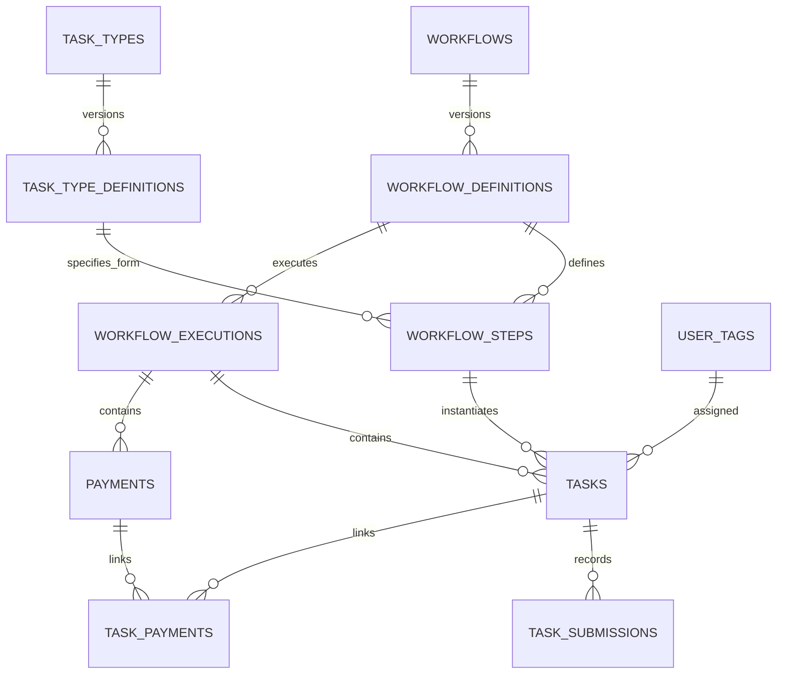

# Workflow data model

This schema separates reusable process definitions, individual Temporal runs,
shared human tasks and business records. It extends the existing Training Fund
ledger; existing workflows continue using that ledger until explicitly integrated.

## Entities

| Table | Meaning | Identity/relationships |
| --- | --- | --- |
| `workflows` | Process catalogue, with code, name, description and Temporal Workflow Type | Unique code |
| `workflow_definitions` | Business process version | Workflow UUID; unique workflow/version; nullable publication timestamp |
| `task_types` | Reusable task category | Unique code and descriptive name |
| `task_type_definitions` | Versioned input/output JSON Schemas and UI configuration | Task type UUID; unique type/version; nullable publication timestamp |
| `workflow_steps` | Human step definition, instructions and default team | Workflow definition, task type definition and user tag UUIDs; unique code within definition |
| `workflow_executions` | One actual Temporal run | Definition UUID; unique namespace/Temporal Workflow ID/Run ID |
| `tasks` | One occurrence of a human step | Execution, step and assigned tag UUIDs; positive occurrence number |
| `task_submissions` | Append-only submitted answers | Task and submitting user UUIDs, answers JSON, timestamp |
| `payments` | GBP payment record | Execution UUID, payee, positive integer amount in pence, nullable transaction date/reference and recording audit |
| `task_payments` | Links multiple tasks to a shared payment | Task/payment UUIDs; unique pair |
| `user_tags` | Team/category definitions | Unique workflow lookup code |
| `user_tag_memberships` | Many-to-many email membership | User email/tag UUIDs; unique pair |

Every table has a UUID primary key. Application-owned identities are generated;
foreign keys never generate values. Temporal Run IDs are external UUID values,
not foreign keys to our tables. Temporal Workflow IDs remain external strings.
Execution identity assumes one configured Temporal service; add service identity
before projecting multiple independent services into this database.

## Publishing and execution

1. Create a task type definition with JSON Schemas for displayed input and submitted
   output, plus UI configuration. Publish it after validating its schemas.
2. Create a draft workflow definition and its steps, each referencing a published
   task type definition. Publish the workflow definition when ready.
3. Record an actual Temporal run against the published workflow definition.
4. Instantiate tasks with that run, a step from the same definition, the actual
   assigned tag, and an occurrence number. Copy the step's default tag explicitly.

Published definitions cannot be changed or deleted. Steps cannot be added,
changed or removed after their workflow definition is published. Executions
require published definitions, and their identity/definition cannot be changed.
A task cannot point to a step from a different version. Its occurrence identity
cannot be changed after insertion.

One execution can repeat a step using occurrence 2, 3, etc. Retrying creation of
occurrence 1 must reuse that identity. A new Temporal run is a new execution row,
even if its Workflow ID is the same. `first_execution_run_id` optionally records
chain identity. Continue-As-New task carry-over requires explicit application
logic; this schema does not automatically duplicate or transfer open tasks.
Business version numbers do not implement Temporal worker versioning or replay
compatibility. Execution statuses mirror Temporal's run statuses, independently
of task statuses (`pending`, `in_progress`, `completed`).

## Forms, evidence and payment data

Task `context` stores the displayed input snapshot, pinned to its step's form
version. `draft_answers` is nullable JSON. Immutable submission rows record final
answers and the submitting user. Nullable task audit fields record creation,
update and completion metadata; they are not a complete event log. Context
immutability and audit timestamp population are caller responsibilities.

JSON columns are typed as objects in TypeScript. Definition columns enforce JSON
object shape in PostgreSQL; full JSON Schema compilation, runtime answer validation
and UI interpretation belong to the application service. Direct SQL inserts are
not validated against the stored JSON Schema. No general form renderer, completion
API or workflow synchronisation has been added by this schema change.

Payment records can exist before a transaction is recorded, so transaction date,
reference and recording audit fields are nullable. Amounts are GBP integer pence.
Several tasks may link to one payment through `task_payments`; links can span runs
when work continues as new. No bank-account table or bank-detail fields are included.

An eventual completion service must authorise an active member of the task's tag,
validate input/output against the pinned schema, and atomically write submission,
payment changes and task completion. Coordinate acknowledgement with Temporal
using retry-safe identities. Merely setting the database status does not advance
Temporal. Membership is live; tasks are shared team work, not individual approvals
required from every member.

## Business cases and summary metrics

`workflow_cases` is the reporting unit: one Training Fund application or one award.
It has a UUID, workflow reference, optional definition reference (legacy applications
have no registered definition), reference/title, open/completed/cancelled status,
business outcome and opened/closed timestamps. `workflow_case_executions` is a
many-to-many association: an awards import run may serve many cases and a case may
use many Temporal runs. Run status never determines case completion.

Migration 0014 backfills existing applications and awards and projects future
changes transactionally through database triggers. Application payment completion
closes the application case; award presentation closes the award case. Trigger
projections use stable domain identities, so retries do not create new cases.
Generic cases can be maintained directly by their business services.

Applications, award progress, tasks and payments have direct case UUID references.
Existing task/execution provenance remains for compatibility with running workers.
For an execution associated with exactly one case, new task/payment rows inherit
that case; multi-case workflows must supply the specific case explicitly. Awards
assign their case when award progress is created. Unrelated operational tasks
may have no business case and are excluded from business metrics.

Workflow summaries and authenticated landing summaries count cases, not tasks or
Temporal runs. Training Fund summaries remain workflow-wide; awards retain the
existing DLV/assignee visibility scope. Anonymous visitors see no case totals.
